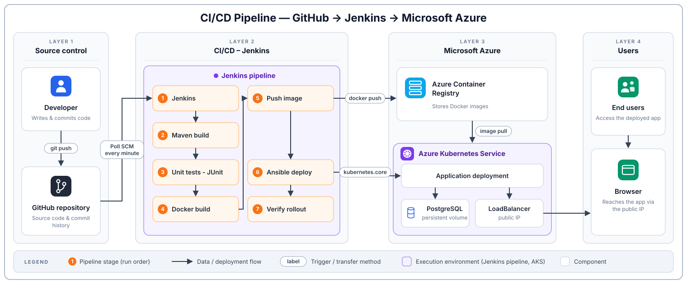

# Spice Route – Restaurant App with a DevOps Azure Pipeline

**Spice Route** is a restaurant web application (online ordering, live order tracking, table
reservations and a kitchen dashboard) delivered through an end-to-end CI/CD pipeline. Every push to
`main` is built, tested, containerised, published to Azure Container Registry and deployed to Azure
Kubernetes Service automatically, with no manual steps.

**Live application:** the public IP of the `devops-app` LoadBalancer service on AKS, printed as
"Application URL" at the end of every Jenkins build (available while the cluster is running).

## Application features

| Page | For | What it does |
|---|---|---|
| Menu (`/`) | Customers | Menu by category with veg/non-veg markers, spicy tags, search and a veg-only filter; cart with live GST bill; place dine-in (table number) or takeaway orders |
| Track order (`/track.html`) | Customers | Live status timeline (Placed → Preparing → Ready → Served), refreshes every 5 seconds |
| Book a table (`/reserve.html`) | Customers | Reservations in 30-minute slots (11:00–22:30), up to 60 days ahead, max 12 guests, 8 tables per slot |
| Kitchen (`/kitchen.html`) | Staff | Order board by status with workflow buttons, today's reservations, menu availability switches |

The footer of every page shows the app version, Jenkins build number and the pod that served it,
so each redeployment is visible in the browser.

## Architecture



## Tools

| Concern | Tool | Notes |
|---|---|---|
| Source control | Git + GitHub | Public repository, `main` branch triggers the pipeline |
| CI/CD | Jenkins | Declarative `Jenkinsfile`, Poll SCM trigger |
| Secret scanning | Gitleaks 8.30.1 | Runs as a Docker container in the pipeline |
| Application | Spring Boot 3.5 (Java 21), Spring Data JPA, Bean Validation | REST API + static HTML/CSS/JS frontend |
| Database | PostgreSQL 16 (Kubernetes), H2 (local and tests) | Schema and seed menu managed by Flyway migrations |
| Build & test | Maven, JUnit 5, MockMvc | 35 unit and API tests run in every build |
| Containerisation | Docker | `eclipse-temurin:21-jre-alpine`, non-root user |
| Registry | Azure Container Registry | `pranovdevopsacr.azurecr.io` (Basic) |
| Orchestration | Azure Kubernetes Service | `aks-devops-cia2`, Central India, free tier, 1 node |
| Configuration / deploy | Ansible | `kubernetes.core` collection, run from WSL (Ubuntu) |
| Local cluster | Minikube | Optional deploy target for development |

## Repository layout

```
├── src/main/java/com/pranov/devops/
│   ├── menu/                  Menu items and categories
│   ├── order/                 Orders, pricing (5% GST) and the kitchen status workflow
│   ├── reservation/           Table reservations and slot rules
│   ├── info/                  /api/info (version, build, pod) used by the footer and smoke test
│   └── common/                Error handling and clock configuration
├── src/main/resources/
│   ├── static/                Frontend pages, CSS and JavaScript
│   ├── db/migration/          Flyway SQL: schema and seed menu
│   └── application.properties
├── src/test/java/...          Unit and API tests
├── pom.xml                    Maven build (version shown in the app comes from here)
├── Dockerfile                 Runtime image for the packaged jar
├── .dockerignore              Keeps the build context to target/app.jar
├── Jenkinsfile                CI/CD pipeline definition
├── k8s/                       Kubernetes manifests (Jinja2 templates rendered by Ansible)
│   ├── namespace.yaml
│   ├── deployment.yaml        App: 2 replicas, rolling update, startup/readiness/liveness probes, limits
│   ├── service.yaml           NodePort on Minikube, LoadBalancer on AKS
│   └── postgres.yaml          PostgreSQL: persistent volume claim, deployment, internal service
└── ansible/
    ├── inventory.ini
    └── deploy.yml             Secrets, PostgreSQL, app rollout, smoke test
```

## Pipeline stages

| Stage | What it does |
|---|---|
| Checkout | Fetches the commit and tags the image as `<build number>-<short commit>` |
| Secret Scan (Gitleaks) | Scans the full git history for passwords, keys and tokens with Gitleaks; any finding fails the build before anything is built or deployed. The JSON report is archived with the build |
| Maven Build | `mvn clean package` compiles and packages `target/app.jar` |
| Unit Tests | `mvn test`; results are published to Jenkins with the JUnit plugin |
| Docker Build | Builds the image with the version tag and `latest` |
| Push to ACR | Logs in with the `acr-credentials` Jenkins credential and pushes both tags |
| Deploy with Ansible | Runs `ansible/deploy.yml`: namespace, registry pull secret, database secret, PostgreSQL, app deployment and service, rollout wait, in-cluster smoke test (new build + menu from the database), public URL |
| Verify Deployment | `kubectl rollout status` and a listing of the deployment, pods and service |

The `DEPLOY_TARGET` build parameter selects the cluster: `aks` (default, used by automatic builds)
or `minikube`.

## API

| Method & path | Description |
|---|---|
| `GET /api/menu?category=` | Menu items, optionally filtered by category |
| `GET /api/menu/categories` | Categories with display labels |
| `POST /api/menu` | Add a dish |
| `PATCH /api/menu/{id}/availability` | Mark a dish available or sold out |
| `POST /api/orders` | Place an order (bill calculated on the server) |
| `GET /api/orders/{id}` | Order details and status |
| `GET /api/orders?includeCompleted=` | Kitchen view of active (or all) orders |
| `PATCH /api/orders/{id}/status` | Move an order to its next status |
| `POST /api/reservations` | Book a table |
| `GET /api/reservations?date=` | Reservations for a date (today by default) |
| `PATCH /api/reservations/{id}/cancel` | Cancel a reservation |
| `GET /api/info` | Version, Jenkins build and pod (footer and pipeline smoke test) |
| `GET /actuator/health` | Health check used by the Kubernetes probes |

Invalid requests return `400` and unknown ids `404`, both as `{"error": "..."}`.

## Running it

### Prerequisites
- Java 21, Maven, Docker, Git, kubectl
- Jenkins (`java -jar jenkins.war`) with the Git, Pipeline, Credentials Binding, JUnit and Timestamper plugins
- WSL Ubuntu with Ansible, the `kubernetes.core` collection and `python3-kubernetes`
- Azure subscription with a container registry and an AKS cluster (or Minikube for a local cluster)

### Local build
```bash
mvn clean verify                       # build and run the tests
java -jar target/app.jar               # http://localhost:8080 (in-memory H2 database)
docker build -t devops-azure-pipeline .
docker run -p 8080:8080 devops-azure-pipeline
```

### Azure resources
```bash
az group create --name rg-devops-cia2 --location centralindia
az acr create --resource-group rg-devops-cia2 --name pranovdevopsacr --sku Basic --admin-enabled true
az aks create --resource-group rg-devops-cia2 --name aks-devops-cia2 --location centralindia \
  --tier free --node-count 1 --node-vm-size Standard_B2als_v2 --generate-ssh-keys
az aks get-credentials --resource-group rg-devops-cia2 --name aks-devops-cia2 --context aks-devops-cia2
```

### Jenkins job
1. Add a *Username with password* credential with ID `acr-credentials` (registry admin user).
2. Create a **Pipeline** job, *Pipeline script from SCM*, repository
   `https://github.com/Pranov123/devops_azure_pipeline.git`, branch `*/main`, script path `Jenkinsfile`.
3. Run it once; afterwards every push to `main` triggers a build within a minute.

### Manual deploy with Ansible
```bash
cd ansible
export ACR_USER=... ACR_PASS=... K8S_AUTH_KUBECONFIG=~/.kube/config
ansible-playbook -i inventory.ini deploy.yml -e image_tag=<tag> -e build_number=<n> -e service_type=LoadBalancer
```

## Security notes
- Every build runs a Gitleaks scan of the whole repository history, so a committed secret stops the
  pipeline before it can reach the registry or the cluster.
- Registry password is stored only as a Jenkins credential, masked in logs and passed to Ansible
  through environment variables; the pull secret task uses `no_log`.
- The kubeconfig written for Ansible is deleted at the end of every build and is git-ignored.
- The database password is generated randomly by Ansible on the first deploy and stored only in the
  `restaurant-db` Kubernetes Secret; PostgreSQL has no public endpoint (ClusterIP service).
- All user input is validated on the server, and the frontend escapes values before rendering them.
- Containers run as a non-root user (UID 10001) without privilege escalation, with CPU and memory limits.
- Limitations: the registry admin user and a plain-HTTP endpoint are used for simplicity, and the
  kitchen dashboard has no login; a production setup would add authentication, managed identities,
  HTTPS ingress, a managed database with backups and a webhook-triggered Jenkins.

## Cleanup
```bash
az aks stop --resource-group rg-devops-cia2 --name aks-devops-cia2   # pause compute cost
az group delete --name rg-devops-cia2 --yes                          # remove everything
```
