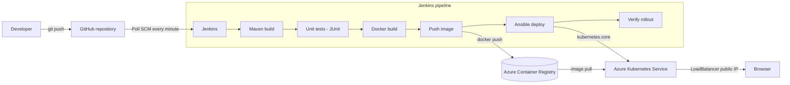

# DevOps Azure Pipeline

End-to-end CI/CD pipeline for a Java web application. Every push to `main` is built, tested,
containerised, published to Azure Container Registry and deployed to Azure Kubernetes Service
automatically, with no manual steps.

**Live application:** http://4.224.72.226/ (AKS LoadBalancer, available while the cluster is running)

## Architecture



## Tools

| Concern | Tool | Notes |
|---|---|---|
| Source control | Git + GitHub | Public repository, `main` branch triggers the pipeline |
| CI/CD | Jenkins | Declarative `Jenkinsfile`, Poll SCM trigger |
| Build & test | Maven, JUnit 5, MockMvc | Spring Boot 3.5 on Java 21 |
| Containerisation | Docker | `eclipse-temurin:21-jre-alpine`, non-root user |
| Registry | Azure Container Registry | `pranovdevopsacr.azurecr.io` (Basic) |
| Orchestration | Azure Kubernetes Service | `aks-devops-cia2`, Central India, free tier, 1 node |
| Configuration / deploy | Ansible | `kubernetes.core` collection, run from WSL (Ubuntu) |
| Local cluster | Minikube | Optional deploy target for development |

## Repository layout

```
├── src/main/java/...          Spring Boot application (home page, /api/info, /api/add)
├── src/test/java/...          Unit and web-layer tests
├── pom.xml                    Maven build (version shown in the app comes from here)
├── Dockerfile                 Runtime image for the packaged jar
├── .dockerignore              Keeps the build context to target/app.jar
├── Jenkinsfile                CI/CD pipeline definition
├── k8s/                       Kubernetes manifests (Jinja2 templates rendered by Ansible)
│   ├── namespace.yaml
│   ├── deployment.yaml        2 replicas, rolling update, health probes, resource limits
│   └── service.yaml           NodePort on Minikube, LoadBalancer on AKS
└── ansible/
    ├── inventory.ini
    └── deploy.yml             Deploy, wait for rollout, smoke test
```

## Pipeline stages

| Stage | What it does |
|---|---|
| Checkout | Fetches the commit and tags the image as `<build number>-<short commit>` |
| Maven Build | `mvn clean package` compiles and packages `target/app.jar` |
| Unit Tests | `mvn test`; results are published to Jenkins with the JUnit plugin |
| Docker Build | Builds the image with the version tag and `latest` |
| Push to ACR | Logs in with the `acr-credentials` Jenkins credential and pushes both tags |
| Deploy with Ansible | Runs `ansible/deploy.yml`: namespace, registry pull secret, deployment, service, rollout wait, in-cluster smoke test, public URL |
| Verify Deployment | `kubectl rollout status` and a listing of the deployment, pods and service |

The `DEPLOY_TARGET` build parameter selects the cluster: `aks` (default, used by automatic builds)
or `minikube`.

## Application endpoints

| Path | Description |
|---|---|
| `/` | Home page with version, Jenkins build number and serving pod |
| `/api/info` | Same details as JSON |
| `/api/add?a=2&b=3` | Small calculation endpoint covered by tests |
| `/actuator/health` | Health check used by the Kubernetes liveness and readiness probes |

## Running it

### Prerequisites
- Java 21, Maven, Docker, Git, kubectl
- Jenkins (`java -jar jenkins.war`) with the Git, Pipeline, Credentials Binding, JUnit and Timestamper plugins
- WSL Ubuntu with Ansible, the `kubernetes.core` collection and `python3-kubernetes`
- Azure subscription with a container registry and an AKS cluster (or Minikube for a local cluster)

### Local build
```bash
mvn clean verify                       # build and run the tests
docker build -t devops-azure-pipeline .
docker run -p 8080:8080 devops-azure-pipeline
```

### Azure resources
```bash
az group create --name rg-devops-cia2 --location centralindia
az acr create --resource-group rg-devops-cia2 --name pranovdevopsacr --sku Basic --admin-enabled true
az aks create --resource-group rg-devops-cia2 --name aks-devops-cia2 --location centralindia \
  --tier free --node-count 1 --node-vm-size Standard_B2als_v2 --generate-ssh-keys
az aks get-credentials --resource-group rg-devops-cia2 --name aks-devops-cia2 --context aks-devops-cia2
```

### Jenkins job
1. Add a *Username with password* credential with ID `acr-credentials` (registry admin user).
2. Create a **Pipeline** job, *Pipeline script from SCM*, repository
   `https://github.com/Pranov123/devops_azure_pipeline.git`, branch `*/main`, script path `Jenkinsfile`.
3. Run it once; afterwards every push to `main` triggers a build within a minute.

### Manual deploy with Ansible
```bash
cd ansible
export ACR_USER=... ACR_PASS=... K8S_AUTH_KUBECONFIG=~/.kube/config
ansible-playbook -i inventory.ini deploy.yml -e image_tag=<tag> -e build_number=<n> -e service_type=LoadBalancer
```

## Security notes
- Registry password is stored only as a Jenkins credential, masked in logs and passed to Ansible
  through environment variables; the pull secret task uses `no_log`.
- The kubeconfig written for Ansible is deleted at the end of every build and is git-ignored.
- Containers run as a non-root user (UID 10001) without privilege escalation, with CPU and memory limits.
- Limitations: the registry admin user and a plain-HTTP endpoint are used for simplicity; a production
  setup would use managed identities, HTTPS ingress and a webhook-triggered Jenkins.

## Cleanup
```bash
az aks stop --resource-group rg-devops-cia2 --name aks-devops-cia2   # pause compute cost
az group delete --name rg-devops-cia2 --yes                          # remove everything
```
